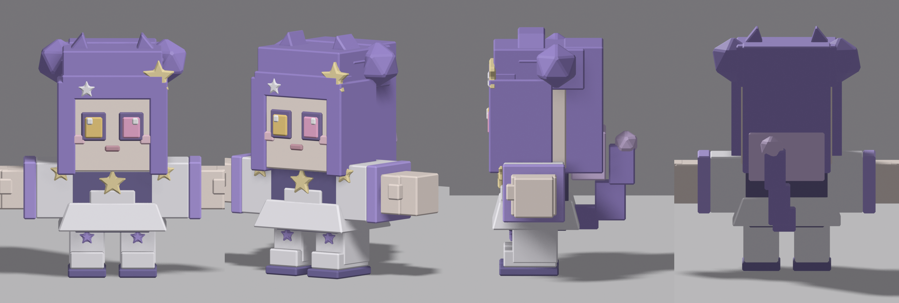
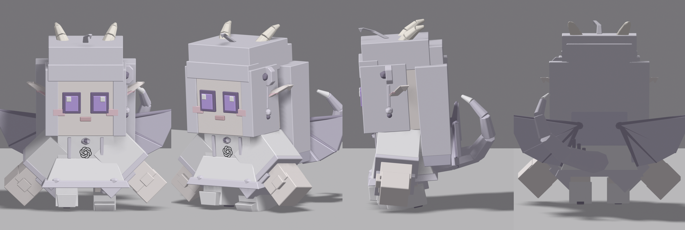
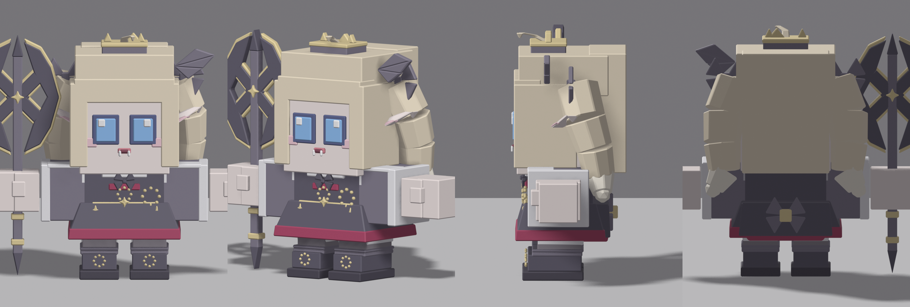
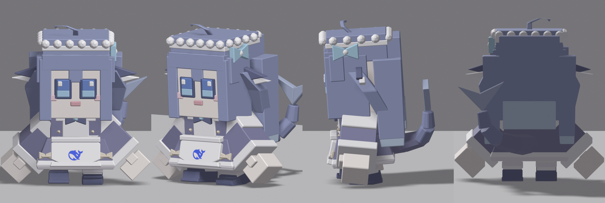
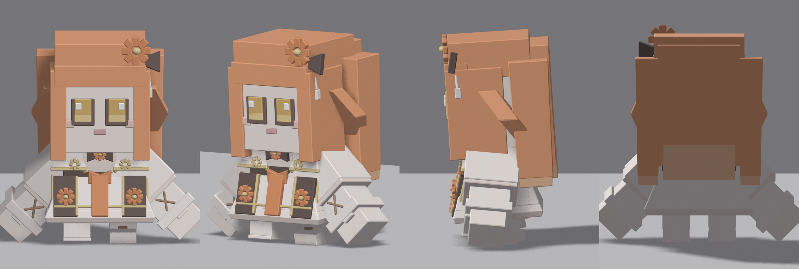
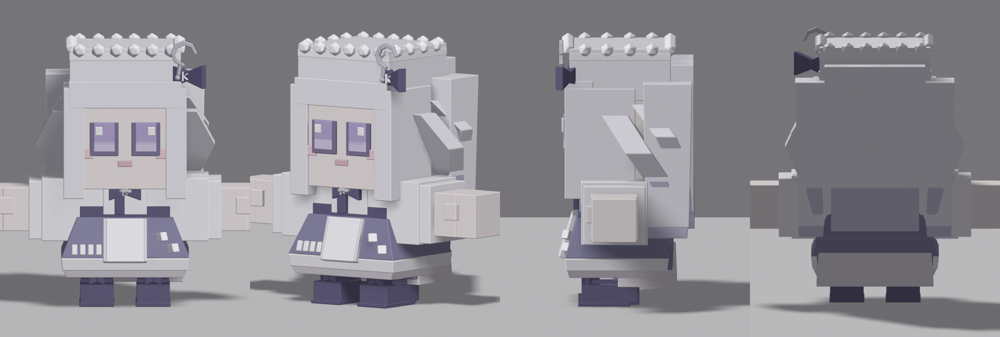
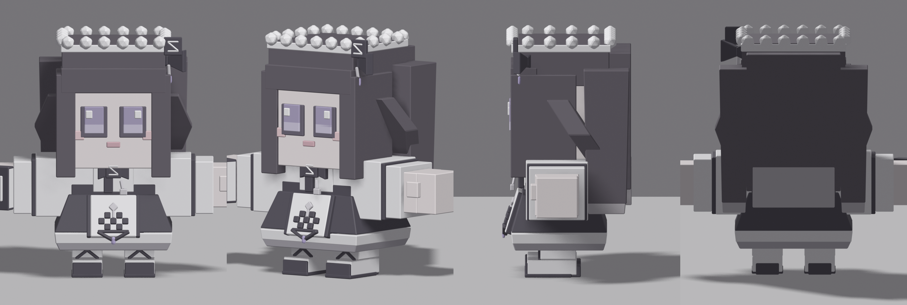
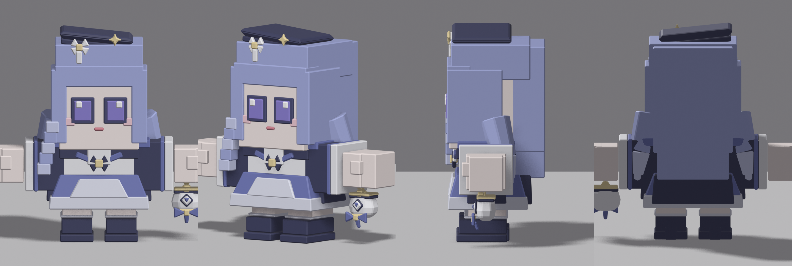

# pi-meeting-chibis

8 个程序化生成的 chibi 角色模型：几何、配色、贴花、徽章全部由 Blender Python 脚本写出来，
没有手工建模。每个模型是一个自带骨架和 32 个动作的 GLB，丢进 Three.js 或 Blender 就能用。

最初为 [pi-ai-meeting-visualizer](https://github.com/ArnoldRedman/pi-ai-meeting-visualizer)（多模型会议场景）制作，现在单独维护，可以拿去改。

## 角色一览

| 模型 | 角色 | 总高 | 说明 |
| --- | --- | --- | --- |
| `characters/character-gemini.glb` | Gemini 席位（紫双马尾） | 0.7995 | 自制，无贴图，全是几何体 |
| `characters/character-gpt.glb` | GPT 席位（白龙娘） | 0.8176 | 裙子正面的 OpenAI 标志是贴花，贴图已内嵌进 GLB，源图 `characters/textures/openai.png` |
| `characters/character-grok.glb` | Grok 席位（金发吸血鬼贵族） | 0.8174 | 右手握全尺寸 X 战斧；武器刚性绑在 `arm-right` 上 |
| `characters/character-deepseek.glb` | DeepSeek 席位（蓝鲸女仆） | 0.8080 | 围裙上的鲸鱼标志用官网图标贴花，源图 `characters/textures/deepseek.png` |
| `characters/character-claude.glb` | Claude 席位（橙发大小姐） | 0.7848 | 无贴图：花、蝴蝶结、流苏都是几何体 |
| `characters/character-kimi.glb` | Kimi 席位（银发月光音乐少女） | 0.8026 | 无贴图：新月用几段小方块排成弧形 |
| `characters/character-glm.glb` | GLM 席位（黑发女仆档案管理员） | 0.7810 | 无贴图："Z" 徽章、裙面几何花纹、右手的 "GLM Model" 手册都是几何体 |
| `characters/character-qwen.glb` | Qwen 席位（蓝发汉服少女） | 0.8059 | 无贴图：标志菱形、蝴蝶结、流苏都是几何体；左手提袋刚性绑在 `arm-left` 上 |

## 四视角预览

每张 `4v.png` 是正 / 斜侧 / 侧 / 背横排，单张视角图（`front` `quarter` `side` `back` `top` `sit` `walk` `interact`）都在同目录下。

### gemini



### gpt



### grok



### deepseek



### claude



### kimi



### glm



### qwen



## 目录结构

```
characters/             8 个 GLB；<名字>-work.blend 是开 GUI 调形的中间文件；textures/ 是贴花源图
characters/preview/     每个角色 9 张预览（4v.png + 8 张单视角）
tools/characters/       生成器：chibi.py 几何库 + 每个角色一个设计脚本 + 建模 / 预览 / 调形入口
tools/characters/base/  构建的输入骨架（Kenney Mini Characters，CC0）
参考图/                 设计参考图（第三方素材，不在本仓库许可证覆盖范围内，公开仓库建议排除）
```

## 规格

- 骨架 7 根骨头：`root`、`torso`、`head`、`leg-left`、`leg-right`、`arm-left`、`arm-right`，无肘无膝；每个部位刚性绑定到一根骨头
- 32 个动作，含 `idle`、`walk`、`sit`、`static`、`interact-right`、`emote-no`
- bind 空间是 T-pose、正面朝 -Y；+x 在正面视图里是观众右侧
- 总高（含饰物）落在 0.78～0.82，做新角色时留在这个区间，同场角色体型才一致（缩放交给使用方，会议场景里统一缩到 1.35 米）
- 单个 GLB 体积 0.5～1.0 MB，贴图（如果有）内嵌

## 重建

```
blender -b --factory-startup -P tools/characters/build_character.py -- <名字>
# → characters/character-<名字>.glb，同时覆盖 characters/<名字>-work.blend

blender -b --factory-startup -P tools/characters/preview.py -- characters/character-<名字>.glb characters/preview/<名字> BLENDER_EEVEE 720
# → 该角色 9 张预览；最后用 ffmpeg 拼出 4v.png，所以 PATH 里要有 ffmpeg
```

开 GUI 调形：

```
blender -b --factory-startup -P tools/characters/prepare_scene.py -- <名字>
# 生成 characters/<名字>-work.blend，然后在 Blender 里跑 live_rebuild.py 实时改形、export_live.py 存盘并导出 GLB
```

改完设计脚本**必须重跑重建命令**，否则 `<名字>-work.blend` 和 GLB 会停在旧网格上、和脚本对不上。

## 来源与署名

- 骨架与 32 个动作来自 [Kenney Mini Characters](https://kenney.nl/assets/mini-characters)（CC0，见 `tools/characters/base/License.txt`）。本项目不复用它的网格，只复用骨骼与动作，所以坐姿偏移和动作表现沿用原校准
- 几何、配色、贴花、徽章由 `tools/characters/*.py` 程序化生成
- 角色形象参考各模型的品牌视觉，是粉丝向的非官方作品

## 已知代价

- **手持道具是刚性绑定**：Grok 的斧子、Qwen 的提袋、GLM 的手册都绑在单根手臂骨上，动作把手臂前摆约 60° 时道具跟着转（斧子会倒成横向）。一份网格只能绑一根骨头，做不了双手对握
- 倾斜面上的贴花是按面法线偏移的近似贴合，不是 UV 投影
- 没有表情骨骼和 IK，情绪靠 `emote-*` 动作

## 许可证

[CC BY-NC-SA 4.0](LICENSE)（署名 — 非商业性使用 — 相同方式共享）：

- 可自由使用、复制、修改、再分发，包括用于开源项目和个人项目
- **禁止任何商业性使用**；商业使用必须事先取得作者单独授权（通过 GitHub 联系 [@ArnoldRedman](https://github.com/ArnoldRedman)）
- 分发（含修改后分发）必须保留署名 ArnoldRedman 与本许可证声明，修改后的作品必须以同一许可证发布

`参考图/` 里的第三方设计图、模型上引用到的品牌标志不在本许可证覆盖范围内，详见 [LICENSE](LICENSE)。
